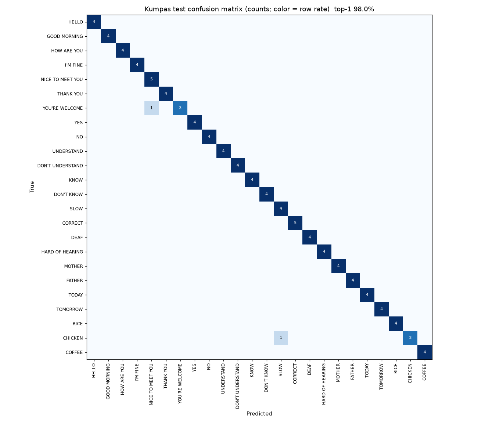

# Kumpas classifier report

Summary, confusions and per-class numbers are measured on the FSL-105 **test split** for the 24 chosen classes (generated by `ml/train.py`).

## Summary

| Metric | Value |
|---|---|
| Top-1 accuracy | **98.0%** (96/98) |
| Top-3 accuracy | **98.0%** |
| Classes | 24 |
| Clips: train / val / test | 336 / 57 / 98 |
| Best val accuracy (checkpoint selection) | 100.0% at epoch 48 |
| Model | 2-layer GRU, hidden 128, dropout 0.3, 206,616 params |
| Input | [1, 32, 142] (feature spec v1, see FEATURES.md) |
| Training | 200 epochs on `mps`, 75 s, seed 0 |

Caveat: the test split has only 4–5 clips per class, so a single error moves a class's accuracy by 20%–25%. Per-class numbers and confusions are noisy.

**Signer overlap:** FSL-105 has 4 signers, and the official split puts clips from all 4 in both train and test. So this split measures accuracy on *signers seen in training*. See "Unseen-signer accuracy" below for the number that better predicts a new user.

## Confused pairs (> 15% of a class's test clips)

| True | Predicted as | Rate | Count |
|---|---|---|---|
| CHICKEN | SLOW | 25% | 1/4 |
| YOU'RE WELCOME | NICE TO MEET YOU | 25% | 1/4 |

## Per-class accuracy

| Class | Accuracy | Correct / clips |
|---|---|---|
| YOU'RE WELCOME | 75% | 3/4 |
| CHICKEN | 75% | 3/4 |
| HELLO | 100% | 4/4 |
| RICE | 100% | 4/4 |
| TOMORROW | 100% | 4/4 |
| TODAY | 100% | 4/4 |
| FATHER | 100% | 4/4 |
| MOTHER | 100% | 4/4 |
| HARD OF HEARING | 100% | 4/4 |
| DEAF | 100% | 4/4 |
| CORRECT | 100% | 5/5 |
| SLOW | 100% | 4/4 |
| KNOW | 100% | 4/4 |
| DON'T UNDERSTAND | 100% | 4/4 |
| UNDERSTAND | 100% | 4/4 |
| NO | 100% | 4/4 |
| YES | 100% | 4/4 |
| THANK YOU | 100% | 4/4 |
| NICE TO MEET YOU | 100% | 5/5 |
| I'M FINE | 100% | 4/4 |
| HOW ARE YOU | 100% | 4/4 |
| GOOD MORNING | 100% | 4/4 |
| DON'T KNOW | 100% | 4/4 |
| COFFEE | 100% | 4/4 |

## Confusion matrix

## Unseen-signer accuracy (leave-one-signer-out)

FSL-105 has 4 signers; each clip's signer was identified by body-geometry segmentation and verified visually on all 24 classes (`assign_signers`). Each fold trains on 3 signers (15% held out for checkpoint selection) and tests on every clip of the 4th signer. Same model, features and training settings as above.

| Held-out signer | Clips | Top-1 | Top-3 |
|---|---|---|---|
| 0 | 121 | 88.4% | 95.0% |
| 1 | 122 | 93.4% | 97.5% |
| 2 | 125 | 95.2% | 100.0% |
| 3 | 123 | 87.8% | 93.5% |
| **All folds pooled** | 491 | **91.2%** | **96.5%** |

Mean of folds: top-1 91.2%, top-3 96.5%.

### Unseen-signer confused pairs (> 15%, pooled over all folds)

Based on ~20 clips per class, so less noisy than the test-split list above.

| True | Predicted as | Rate | Count |
|---|---|---|---|
| SLOW | COFFEE | 29% | 6/21 |
| CORRECT | YOU'RE WELCOME | 23% | 5/22 |
| FATHER | CHICKEN | 20% | 4/20 |
| TOMORROW | YES | 19% | 4/21 |
| HOW ARE YOU | COFFEE | 19% | 4/21 |

### Unseen-signer per-class accuracy (pooled)

| Class | Accuracy |
|---|---|
| SLOW | 67% (14/21) |
| CORRECT | 73% (16/22) |
| TOMORROW | 76% (16/21) |
| FATHER | 80% (16/20) |
| YOU'RE WELCOME | 80% (16/20) |
| HOW ARE YOU | 81% (17/21) |
| RICE | 85% (17/20) |
| YES | 85% (17/20) |
| CHICKEN | 90% (18/20) |
| NO | 90% (19/21) |
| DEAF | 90% (19/21) |
| HELLO | 95% (19/20) |
| TODAY | 100% (20/20) |
| MOTHER | 100% (20/20) |
| HARD OF HEARING | 100% (20/20) |
| KNOW | 100% (21/21) |
| DON'T UNDERSTAND | 100% (21/21) |
| UNDERSTAND | 100% (20/20) |
| THANK YOU | 100% (20/20) |
| NICE TO MEET YOU | 100% (22/22) |
| I'M FINE | 100% (20/20) |
| GOOD MORNING | 100% (20/20) |
| DON'T KNOW | 100% (20/20) |
| COFFEE | 100% (20/20) |

<!-- onnx-parity:start -->
## ONNX parity (`ml/export.py`)

`web/public/models/kumpas.onnx` (opset 17, 833 KB) vs PyTorch (CPU) on all 98 test clips, batch size 1:

| Check | Value |
|---|---|
| Max abs prob difference | 2.98e-07 |
| Top-1 agreement | 100.0% |
| Top-1 accuracy, ONNX Runtime | 98.0% |
| Top-1 accuracy, PyTorch | 98.0% |
<!-- onnx-parity:end -->
